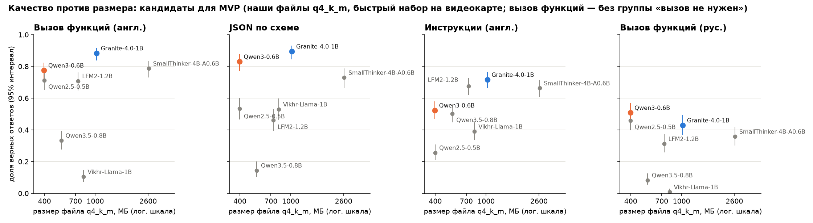

# Выбор модели для MVP

**Итог:** основная модель — **IBM Granite-4.0-1B** (`q4_k_m`, 1024 МБ), лёгкая — **Qwen3-0.6B**
(`q4_k_m`, 397 МБ). Обе — Apache-2.0. Как получены цифры — [METHODOLOGY.md](METHODOLOGY.md).

## 1. Кандидаты и отсев

Сначала смотрели на то, что вообще пригодно для телефона: размер до ~1,5 млрд параметров (или MoE, целиком
помещающийся в 2–3 ГБ), поддержка в llama.cpp, лицензия для замеров любая (при равных цифрах предпочитаем
Apache/MIT), русский язык — проверяем замером. Важный технический критерий: ширина слоя модели кратна 256 —
иначе 4-битные K-кванты llama.cpp не применяются, и файл получается крупнее (так было у Qwen2.5-0.5B: его
«4-битный» файл — 6,3 бита на параметр).

| Модель | Параметры | Лицензия | Итог |
|---|---|---|---|
| Qwen2.5-0.5B-Instruct | 0,5 млрд | Apache-2.0 | исходная точка; заметно слабее новых |
| **Qwen3-0.6B** | 0,6 млрд | Apache-2.0 | **лёгкая модель** |
| Qwen3.5-0.8B | 0,87 млрд | Apache-2.0 | отсеяна: JSON по схеме слаб даже у исходной bf16 (0,16); вызов функций в `q4_k_m` разрушается (bf16 0,66 / 0,55 → 0,33 / 0,08). Файлы 5 и 8 бит и рекомендованные производителем параметры генерации не проверяли |
| LFM2-1.2B (Liquid AI) | 1,2 млрд | собственная | отсеяна: слабый вызов функций по-русски и JSON |
| Vikhr-Llama-3.2-1B (русское дообучение Llama 3.2) | 1,2 млрд | Llama 3.2 | отсеяна: вместо вызова функции пересказывает её описание |
| **Granite-4.0-1B (IBM)** | 1,6 млрд | Apache-2.0 | **основная модель** |
| Falcon-H1-1.5B | 1,5 млрд | собственная | **не оценена** на задачах: на видеокарте ответы вырождались в повтор (и с кэшами сервера, и без них), прогон на процессоре не делали. По близости `q4_k_m` (945 МБ) — на уровне Granite (KL 0,11–0,20). Отложена: лицензия не Apache/MIT, а оценка на процессоре — несколько часов |
| SmallThinker-4B-A0.6B (MoE) | 4,3 млрд всего, 0,6 активных | Apache-2.0 | отсеяна: 2,6 ГБ памяти, слаба по-русски, почти всегда вызывает функцию, даже когда не нужно |
| Llama 3.2 1B, Gemma 3 1B | ~1 млрд | собственные | не проверены: закрытые репозитории без доступа; файлы открытых копий отличаются от оригинала, что именно изменено — проверить не смогли |
| MoE от Qwen (Qwen3-30B-A3B и др.) | от 30 млрд | Apache-2.0 | не подходят: даже в 4 битах 17–20 ГБ |

## 2. Сравнение кандидатов

Все модели — наш файл `q4_k_m`, быстрый набор на видеокарте, одинаковый протокол. Английский / русский.
«Вызов функций» — 240 примеров, где вызов нужен; «без лишнего вызова» — отдельная группа из 60 примеров, где
правильно не вызывать функцию (доля верных отказов).

| Модель | Файл, МБ | Вызов функций | Без лишнего вызова | JSON | Инструкции (IFEval) | Математика | Знания (MMLU) | Суммаризация (ROUGE-L) |
|---|---|---|---|---|---|---|---|---|
| Qwen2.5-0.5B | 398 | 0,71 / 0,46 | 0,52 / 0,23 | 0,54 | 0,26 / 0,16 | 0,45 / 0,08 | 0,35 / 0,30 | 0,22 / 0,16 |
| **Qwen3-0.6B** | **397** | **0,78 / 0,51** | **0,92 / 0,92** | **0,83** | **0,52 / 0,28** | **0,57 / 0,34** | **0,30 / 0,24** | **0,25 / 0,19** |
| Qwen3.5-0.8B | 542 | 0,33 / 0,08 | 1,00 / 0,98 | 0,14 | 0,50 / 0,26 | 0,50 / 0,08 | 0,31 / 0,34 | 0,25 / 0,19 |
| LFM2-1.2B | 731 | 0,71 / 0,31 | 0,75 / 0,73 | 0,46 | 0,68 / 0,25 | 0,63 / 0,26 | 0,46 / 0,28 | 0,29 / 0,16 |
| Vikhr-Llama-3.2-1B | 808 | 0,10 / 0,01 | 0,02 / 0,02 | 0,53 | 0,39 / 0,17 | 0,35 / 0,20 | 0,26 / 0,26 | 0,23 / 0,18 |
| **Granite-4.0-1B** | **1024** | **0,88 / 0,43** | **0,72 / 0,63** | **0,90** | **0,72 / 0,31** | **0,74 / 0,42** | **0,51 / 0,37** | **0,30 / 0,21** |
| SmallThinker-4B-A0.6B | 2630 | 0,79 / 0,36 | 0,03 / 0,13 | 0,73 | 0,66 / 0,26 | 0,82 / 0,23 | 0,56 / 0,27 | 0,22 / 0,12 |

(4 задачи из 11; синим — основная модель, оранжевым — лёгкая; построено скриптом
`img/make_quality_vs_size.py` по сохранённым ответам)

**Как читать.** 95% интервалы на 200–300 примерах — от ±0,04 до ±0,07; в группе «без лишнего вызова»
(60 примеров) — около ±0,12. Разница между моделями меньше ~0,1 по одной задаче не доказана; для пары
Granite — Qwen3 мы дополнительно сравнили ответы попарно (раздел 3). У Qwen3-0.6B MMLU на английском и
русском лежит у уровня угадывания (0,25), у Qwen2.5 — русская математика (0,08); варианты этих моделей по
этим задачам не сравниваются. Qwen3-0.6B в таблице — файл без дублирующей копии словаря (см. его карточку);
исходный файл (484 МБ) даёт те же цифры в пределах шума.

## 3. Почему Granite основная, а Qwen3 — лёгкая

**Granite-4.0-1B** — лучшая на основных задачах: вызов функций по-английски 0,88, JSON 0,90, инструкции
0,72. Попарное сравнение ответов на одних и тех же примерах против Qwen3-0.6B: Granite значимо лучше на
вызове функций по-английски, JSON, английских инструкциях, математике и MMLU (p ≤ 0,03), Qwen3 значимо
лучше на вызове функций по-русски (p = 0,01). Лицензия Apache-2.0.

Сжатие до 4 бит Granite переносит почти без потерь, но не совсем: против исходной bf16 попарное сравнение
показывает падение на русском вызове функций (0,475 → 0,429, p = 0,04) и русской математике (0,484 → 0,416,
p = 0,03); на остальных задачах разница в пределах шума. Тестов девять, поправку на множественные
сравнения не делали, так что оба падения — пограничные.

**Слабое место Granite — лишние вызовы.** В примерах, где функцию вызывать не нужно, Granite всё равно
вызывает её в 28% случаев по-английски и в 37% по-русски (Qwen3 — в 8%). Для приложения это значит:
перед выполнением вызова его нужно проверять (подтверждение пользователя или правила на стороне
приложения), а не исполнять вслепую.

Её цена — размер и скорость:

| | Granite-4.0-1B | Qwen3-0.6B |
|---|---|---|
| Файл | 1024 МБ | 397 МБ |
| Пик памяти (контекст 2048) | 1,26–1,28 ГБ | 0,70–0,72 ГБ |
| Генерация (эмулятор) | 36 ток/с | 87 ток/с |
| Первый токен, короткий вопрос (272 / 277 токенов) | 1,4 с | 0,5 с |
| Первый токен, запрос с функциями (1252 / 1274 токена) | 7,2 с | 2,9 с |

(эмулятор x86, 3 круга, медиана — не телефонные цифры. При контексте 4096, который рекомендует манифест,
память по расчёту больше на ~0,16 ГБ у Granite и ~0,22 ГБ у Qwen3: кэш внимания 80 и 112 КБ на токен)

**Qwen3-0.6B** — лучшая среди маленьких: при размере 397 МБ лучше прежней Qwen2.5-0.5B на JSON (0,83
против 0,54), инструкциях и математике; лучше Granite на русском вызове функций (0,51 против 0,43) и реже
вызывает функцию без нужды. Она — запасной вариант для слабых телефонов и для случаев, где важна скорость
ответа.

Переключение между ними — замена файла: обе модели собраны одним конвейером, имеют одинаковый пакет и
одинаковые требования к движку.

## 4. Что пробовали, чтобы ускорить Granite

Цель была — приблизить Granite к Qwen3 по размеру и скорости почти без потери качества.

| Приём | Результат | Взяли? |
|---|---|---|
| Загрузка без отображения файла в память | пик памяти процесса 1,95 → 1,26 ГБ при той же скорости генерации; часть «лишней» памяти при отображении — страницы файла, которые система может вытеснить, так что реальная нагрузка на память меньше, чем показывает пик | **да** (требование к SDK) |
| Flash attention | обработка промпта +45–55%, генерация не меняется; в llama.cpp включён по умолчанию | **да** |
| Кэш постоянного начала промпта (системный промпт, функции) | убирает основную задержку до первого токена (расчёт; в эмуляторе не измеряли) | **да** (требование к SDK) |
| Калибровка imatrix при 4 битах | ближе к исходнику по KL (0,105 → 0,061); против выбранного `q4_k_m` попарно значимых различий нет (лучше на русской математике, p = 0,06; MMLU не хуже, p ≥ 0,14), против bf16 — значимо хуже на MMLU | нет: выигрыш на задачах не доказан, а рецепт сложнее (нужна калибровочная выборка и ручная замена типа одного тензора). Равноценная замена, можно вернуться |
| 3 бита (`q3_k_m` с калибровкой, 860 МБ) | вызов функций 0,88 → 0,71, русская математика 0,42 → 0,33 (3 бита считались на процессоре, 4 — на видеокарте; разница движков — до 0,04, падение вызова функций намного больше) | нет |
| Таблица словаря в 4 битах | −53 МБ, качество то же | не нужно (выигрыш мал) |
| Спекулятивное декодирование с Granite-4.0-350M | единичный замер ускорения не показал, но был признан аномальным; надёжно не измерено | нет |
| Обрезка слоёв с дистилляцией | не пробовали: несколько дней и риск для русского и вызова функций | отложено |
| Другие движки (MNN, LiteRT, ExecuTorch, Genie) | не измеряли. По опубликованным замерам MNN 3.6.1 (Qwen3-0.6B, 4 бита, Snapdragon 8 Elite) генерация на процессоре быстрее, чем на GPU и NPU (94 / 71 / 69 ток/с); ускоритель выигрывает только на обработке промпта. По документации движков на момент обзора Granite-4.0 из коробки поддерживает только llama.cpp | нет |

Вывод: без заметной потери качества Granite держится на 4 битах (~1 ГБ); сравнять её с Qwen3 по размеру и
скорости нашими средствами без потерь нельзя. Задержку до первого токена должен снимать кэш на стороне SDK.

## 5. Риски

- Скорость на настоящем телефоне не измерена; на телефонах со слабой памятью (например, Snapdragon 870,
  LPDDR4X) Granite будет генерировать примерно в темпе чтения, а обработка длинного промпта без кэша займёт
  десятки секунд (оценка).
- Granite вызывает функцию без нужды в 28–37% таких случаев — приложению нужна проверка вызова.
- Русский язык IBM для Granite официально не заявляет; русское качество — наши замеры.
- Llama 3.2 1B и Gemma 3 1B не проверены (нет доступа к оригиналам); Falcon-H1-1.5B не оценён на задачах.
